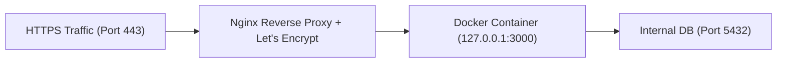

# Cloud & Production Deployment

Plan and execute reliable, zero-downtime deployments with health verification, SSL certificates, reverse proxy configuration, and rollback contingencies.

## When to Use
- Taking an application from local development to production.
- Configuring Nginx reverse proxy, Let's Encrypt SSL, and domain routing.
- Deploying to Vercel, Cloudflare, Railway, Fly.io, or VPS servers.
- Writing GitHub Actions CI/CD workflows for automated build, test, and release.

---

## The Production Readiness Checklist (Run Before Every Deploy)
1. **Secrets & Environment Isolation**:
   - Verify that `.env` files are in `.gitignore`.
   - All production secrets provided via environment variables or secret managers (GitHub Secrets, AWS SSM).
   - Provide an updated `.env.example` with dummy values.
2. **Database Connection Pooling**:
   - Ensure the app uses connection pooling (e.g. PgBouncer, Prisma Accelerate, HikariCP) to prevent exhausting database connections under spike load.
3. **Health & Liveness Probes**:
   - Implement a lightweight `/healthz` or `/health` endpoint that checks DB connectivity.
4. **Graceful Shutdown**:
   - Ensure process listens for `SIGTERM` and `SIGINT`, stops accepting new traffic, finishes in-flight requests, and closes DB connections cleanly.
5. **Reverse Proxy & TLS**:
   - Enforce HTTPS with TLS 1.3.
   - Configure reverse proxy headers: `X-Forwarded-For`, `X-Forwarded-Proto`, `Host`.
   - Set security headers: `Strict-Transport-Security`, `X-Content-Type-Options: nosniff`, `X-Frame-Options: DENY`.

---

## Deployment Architectures

### Option A: Static / Frontend / Edge (Vercel / Cloudflare)
- Connect Git repository directly or use CLI deploy.
- Configure build command and output directory (`dist` or `.next`).
- Set caching headers (`Cache-Control: public, max-age=31536000, immutable` for static assets).

### Option B: VPS with Docker & Nginx Reverse Proxy

1. Install Docker & Nginx on Ubuntu VPS.
2. Run app via `docker-compose -f docker-compose.prod.yml up -d`.
3. Configure Nginx virtual host proxying to `http://127.0.0.1:3000`.
4. Issue automated SSL certificate via Certbot:
   ```bash
   certbot --nginx -d yourdomain.com
   ```

### Option C: Automated CI/CD via GitHub Actions
- Automatic run on push to `main`:
  1. Checkout code.
  2. Run test suites.
  3. Build and tag Docker image.
  4. Push to registry (GHCR / Docker Hub).
  5. Deploy to target server or cloud service via SSH / webhook.

## Output Deliverables
Produce:
1. Production environment documentation (`docs/deploy/DEPLOYMENT-GUIDE.md`).
2. Deployment manifests (Nginx config, Docker Compose prod, GitHub Actions YAML).
