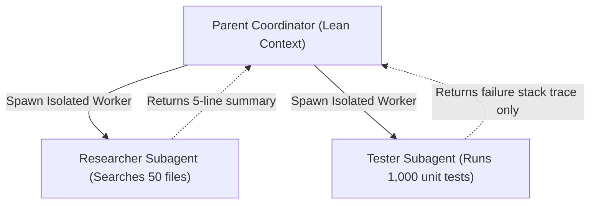

# Context Engineering & Subagent Orchestration

Techniques for managing LLM context windows, reducing token consumption by up to 98%, and orchestrating subagent architectures for complex software engineering.

## When to Use
- Managing multi-hour agent sessions where context is in danger of degrading ("signal-to-noise ratio collapse").
- Processing massive datasets, build logs, or large codebases without blowing token limits.
- Designing multi-agent topologies (Orchestrator, Do-and-Judge, Worker pools).
- Establishing project-wide token efficiency rules.

---

## 1. Subagent Orchestration Patterns

Subagents exist primarily as **Context Firewalls**—to isolate context, explore noise in temporary memory, and pass only dense, high-signal results back to the parent agent.



### Pattern A: The Supervisor / Orchestrator
- The coordinator maintains the high-level roadmap and state.
- Subtasks are delegated to isolated specialist subagents.
- **Rule**: Never pass raw multi-turn conversation history to a subagent; pass *only* the specific objective and necessary file paths.

### Pattern B: The "Do-and-Judge" (Anti-Sycophancy)
- **Problem**: When the same agent writes code and reviews its own code, it rationalizes its own mistakes (confirmation bias).
- **Solution**:
  1. Worker Subagent writes the implementation.
  2. An independent **Judge Subagent** is spawned with *fresh context* and access only to the acceptance criteria and git diff. The Judge evaluates the diff objectively without seeing the worker's internal reasoning.

### Pattern C: Parallel Fan-Out / Fan-In
- When inspecting 3+ independent modules or running multiple test suites, dispatch parallel subagents simultaneously.
- Duration equals the slowest subtask rather than the sum of all subtasks.

### Pattern D: Anti-Recursion Cap
- Always disable recursive subagent spawning (`disallowedTools: ['Agent']` or `tools: ['read', 'write']`) inside worker subagents to prevent infinite fork bombs and runaway token costs.

---

## 2. The 6 Laws of Context Window & Token Optimization

### Law 1: Think-in-Code via Context Mode (Save 95-98% Tokens)
Never dump raw compiler logs, terminal outputs, or whole files into the LLM context memory.
- **Bad**: Running `cat large_file.log` (10,000 lines dumped into chat memory $\rightarrow$ 50,000 tokens wasted).
- **Good**: Running bounded shell pipes:
  ```bash
  grep -E "ERROR|FAIL" build.log | head -n 20
  ```
- **Context Mode**: Use tools like `ctx_execute` or `ctx_search` where computation runs in an external sandbox and only the concise answer enters conversation context.

### Law 2: Precision Slicing (`StartLine` & `EndLine`)
- Never read a 1,500-line source file just to inspect a single helper function.
- First locate the symbol line number with `grep -n "functionName"`, then call `view_file` with an exact 30-line range (`StartLine: 120, EndLine: 150`).

### Law 3: Atomic Diff Editing
- Replace only the exact lines being changed using targeted search/replace.
- Avoid full-file overwrites for minor 2-line changes.

### Law 4: File-System-as-Memory (Externalize State)
- Instead of keeping the entire task progress and past decision history in LLM RAM, persist state to structured Markdown files:
  - `docs/tasks/todo.md`
  - `docs/adr/0001-architecture-decision.md`
  - `status.json`
- In a fresh session, read only the 20-line status file instead of re-reading 50 previous chat turns.

### Law 5: Static Prefix Pinning (Prompt Caching)
- LLMs cache token sequences from the top down.
- **Order matters**:
  1. Static system prompt & unchanging rules (Cached automatically).
  2. Tools definitions (Cached).
  3. Dynamic user message & runtime variables (Processed dynamically).
- Avoid putting dynamic timestamps or random IDs at the very top of system prompts, which invalidates the prompt cache on every turn.

### Law 6: Zero-Fluff Communication
- Eliminate conversational pleasantries: *"I hope you are doing well! I would be delighted to help you refactor this function..."*
- Deliver dense, factual, markdown-linked summaries directly.
