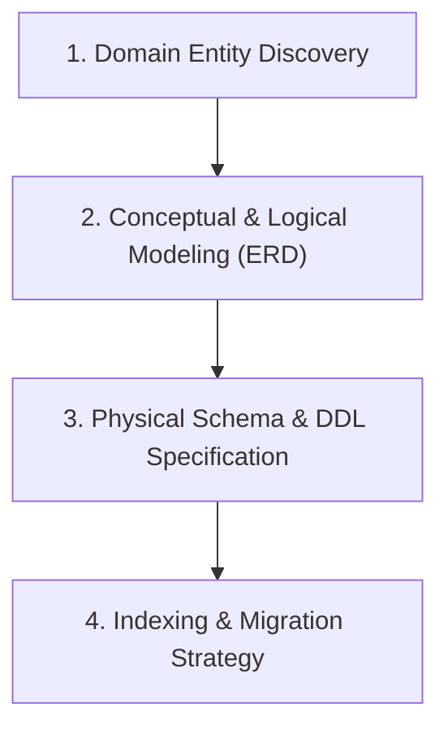
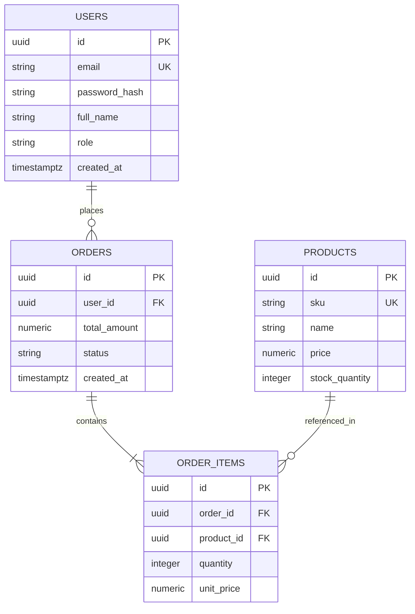

# Database Architecture & Data Modeling

Design scalable, normalized, and performant database schemas for relational (PostgreSQL, MySQL, SQLite) and document/NoSQL (MongoDB, Redis) databases.

## When to Use
- Immediately following the SRS / Requirements definition phase.
- Creating a new database schema or modifying existing table structures.
- Generating Entity-Relationship Diagrams (ERD) for documentation or implementation.
- Planning indexing strategies, foreign keys, or database constraint enforcement.
- Designing schema migrations, especially zero-downtime migrations.

---

## The 4-Stage Database Design Workflow



### Stage 1: Domain Entity & Relationship Discovery
1. Identify **Entities** from the SRS (e.g., `User`, `Tenant`, `Order`, `Product`, `Invoice`).
2. Map Cardinality and Relationships:
   - One-to-One (`1:1`): Embedded vs separate table with unique foreign key.
   - One-to-Many (`1:N`): Foreign key on the "many" side.
   - Many-to-Many (`M:N`): Explicit join/junction table with composite primary or unique key.

### Stage 2: Conceptual & Logical Modeling (Mermaid ERD)
Always produce an initial visual ERD in Mermaid format for instant architectural alignment:


### Stage 3: Physical Schema Design & DDL Rules (PostgreSQL / Relational)
1. **Primary Keys**:
   - Prefer **UUIDv7** (time-sortable, globally unique, avoids B-tree fragmentation) or **BIGINT / BIGSERIAL** for internal sequences. Avoid random UUIDv4 on high-insert write tables.
2. **Data Types**:
   - Money / Currency: Always use `NUMERIC(12, 2)` or integer cents. **NEVER use `FLOAT` or `DOUBLE` for financial amounts.**
   - Timestamps: Always use `TIMESTAMPTZ` (UTC with timezone), never naive `TIMESTAMP`.
   - Strings: Use `VARCHAR(n)` for validated constraints, `TEXT` for freeform text (Postgres stores both identically under the hood).
3. **Integrity & Constraints**:
   - Explicit `NOT NULL` on every column unless NULL is a deliberate business state.
   - Foreign Keys with explicit deletion behavior:
     - `ON DELETE RESTRICT` (default, safest against accidental cascade).
     - `ON DELETE CASCADE` (for dependent child records like order items).
     - `ON DELETE SET NULL` (for soft references).
   - Check Constraints: e.g., `CHECK (price >= 0)`, `CHECK (status IN ('PENDING', 'PAID', 'CANCELLED'))`.
4. **Audit Columns**:
   - Every primary table MUST include:
     ```sql
     created_at TIMESTAMPTZ NOT NULL DEFAULT clock_timestamp(),
     updated_at TIMESTAMPTZ NOT NULL DEFAULT clock_timestamp()
     ```

### Stage 4: Indexing & Performance Engineering
1. **Foreign Key Indexing**: Relational engines do NOT automatically index foreign key columns. **Always create an index on every foreign key** to prevent table locks on delete and accelerate joins.
2. **Leftmost Prefix Rule**: For composite indexes `(tenant_id, status, created_at)`:
   - Queries filtering `WHERE tenant_id = ? AND status = ?` utilize the index.
   - Queries filtering ONLY `status = ?` cannot use this index efficiently.
3. **Partial Indexes**: For queries querying specific subsets:
   ```sql
   CREATE INDEX idx_orders_unprocessed ON orders (created_at) WHERE status = 'PENDING';
   ```
4. **JSONB & Full-Text**: In PostgreSQL, use `GIN` indexes for JSONB queries:
   ```sql
   CREATE INDEX idx_audit_log_payload ON audit_logs USING GIN (payload jsonb_path_ops);
   ```

### Stage 5: Zero-Downtime Migration Pattern (Expand and Contract)
When executing schema migrations in production:
1. **Phase 1 (Expand)**: Add the new column as nullable or with a default. Deploy code that writes to both old and new columns.
2. **Phase 2 (Backfill)**: Run an asynchronous background job to backfill legacy rows.
3. **Phase 3 (Switch)**: Deploy code that reads from the new column.
4. **Phase 4 (Contract)**: Remove old column and clean up fallback logic.

## Output Deliverables
Produce:
1. Architecture document in `docs/database/DATABASE-SCHEMA.md` following `workflows/templates/DATABASE-SCHEMA-TEMPLATE.md`.
2. Executable DDL migration file (e.g. `V1__initial_schema.sql` or Prisma/Alembic schema).
