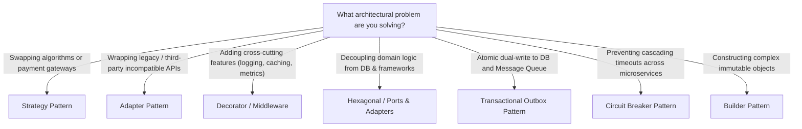

# Pragmatic Design Patterns & Architectural Standards

Architect maintainable, scalable, and testable software systems using established Design Patterns while strictly avoiding premature abstraction and "pattern bloat" (YAGNI).

## When to Use
- Architecting new services, domain modules, or complex feature components.
- Refactoring bloated god-classes, tight coupling, or repetitive procedural logic.
- Decoupling domain business logic from third-party APIs, databases, or frameworks.
- Designing resilient distributed interactions (handling failures, eventual consistency).

---

## 1. The Design Pattern Selection Matrix

---

## 2. Gang of Four (GoF) Pragmatic Patterns

### A. Creational Patterns
1. **Factory Method / Factory Function**:
   - *Problem*: Creating objects whose exact runtime type depends on configuration or input.
   - *Example*: `PaymentProcessorFactory.create(type)` returning `StripeProcessor` or `PaypalProcessor`.
2. **Builder Pattern**:
   - *Problem*: Objects with 5+ constructor arguments, optional parameters, or immutable invariants.
   - *Guideline*: Use fluent builders or typed parameter objects instead of telescoping constructors.

### B. Structural Patterns
1. **Adapter Pattern**:
   - *Problem*: Integrating third-party SDKs or legacy code without polluting domain contracts.
   - *Rule*: Wrap external libraries behind your own domain interface:
     `DomainNotificationPort` $\leftarrow$ `SendGridEmailAdapter` (external).
2. **Decorator Pattern / Middleware Pipeline**:
   - *Problem*: Dynamically attaching responsibilities (caching, authorization, rate-limiting, tracing) without modifying core business classes.
3. **Facade Pattern**:
   - *Problem*: Complex multi-service subsystems (e.g., Order Checkout coordinating Inventory, Billing, Shipping, and Email). Provide a unified, simple entry point.

### C. Behavioral Patterns
1. **Strategy Pattern**:
   - *Problem*: Eliminating huge `switch` or `if-else` blocks for algorithmic variations (e.g., pricing calculations, tax calculators, export formats).
   - *Structure*: Define an interface `PricingStrategy.calculate(order)`; inject concrete implementations.
2. **Observer / Pub-Sub (Domain Events)**:
   - *Problem*: Decoupling side effects. When an order is placed, don't execute 10 secondary tasks synchronously.
   - *Structure*: Aggregate emits `OrderPlacedEvent`; independent subscribers handle emails, inventory deduction, and analytics.
3. **Chain of Responsibility**:
   - *Problem*: Sequential request processing pipelines (e.g., HTTP request middlewares: Auth $\rightarrow$ Validation $\rightarrow$ RateLimit $\rightarrow$ Controller).

---

## 3. Enterprise & Architectural Patterns

### A. Hexagonal Architecture (Ports and Adapters)
Keep business logic at the center, completely free of framework or database dependencies:
- **Domain Core**: Pure business entities, state transitions, and business rules (Zero imports of DB or web frameworks).
- **Ports (Interfaces)**: Driven ports (e.g., `UserRepositoryPort`, `PaymentGatewayPort`) and Driving ports (e.g., `CreateOrderUseCase`).
- **Adapters (Implementations)**:
  - Inbound Adapters: REST Controllers, GraphQL Resolvers, CLI commands.
  - Outbound Adapters: PostgreSQL Repositories, Redis Caches, Stripe Clients.

### B. Repository & Unit of Work
- **Repository**: Emulates an in-memory collection of domain entities (`find_by_id`, `save`, `delete`). Prevents raw SQL / ORM queries from leaking into controllers.
- **Unit of Work**: Maintains a list of business objects affected by a business transaction and coordinates writing out changes atomically.

---

## 4. Distributed & Cloud Resiliency Patterns

### A. Circuit Breaker Pattern
- **Problem**: Downstream API is slow or failing; caller threads hang and exhaust connections, causing cascading outages.
- **States**: `CLOSED` (Normal) $\rightarrow$ `OPEN` (Failures exceed threshold, immediately fail-fast) $\rightarrow$ `HALF-OPEN` (Test probe requests).

### B. Transactional Outbox Pattern
- **Problem**: Writing to PostgreSQL and publishing to Kafka/RabbitMQ in the same business flow. If message broker fails, database state and events diverge.
- **Solution**: Save the domain event into an `outbox` table within the same database transaction. A separate background worker reads the outbox and publishes reliably with at-least-once delivery.

### C. CQRS (Command Query Responsibility Segregation)
- Separate the **Write Model** (optimized for consistency, business invariant validation) from the **Read Model** (optimized for fast queries, denormalized views, caching).

---

## 5. Anti-Patterns & The Over-Engineering Rule (YAGNI)

> **Warning: Avoid "Design Pattern Syndrome"**
1. **Never implement a pattern without a concrete problem**: If simple procedural code with a helper function solves the problem clearly, do not create an abstract factory, visitor, or command bus.
2. **Keep Interfaces Shallow**: Do not create 1-to-1 interfaces for classes that will only ever have one implementation, unless mocking for unit tests requires it.
3. **Prefer Composition over Deep Inheritance**: Never build inheritance trees deeper than 2 levels. Use composition and strategy injection instead.
