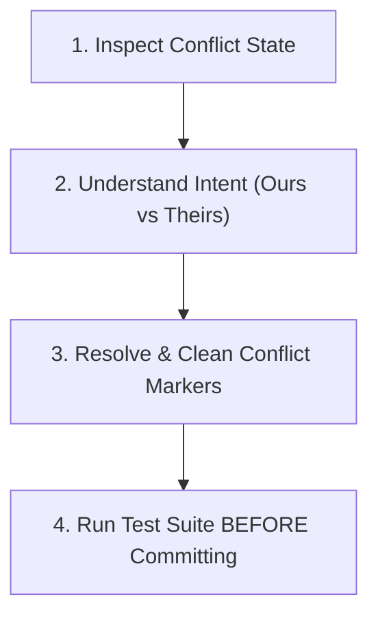

# Git Conflict Resolution & Diagnostic Workflow

Systematically diagnose, unpack, resolve, and verify Git 3-way merge and rebase conflicts safely without loss of intended logic.

## When to Use
- `git merge`, `git pull`, `git rebase`, or `git cherry-pick` halts due to conflicting modifications.
- Conflict markers (`<<<<<<<`, `=======`, `>>>>>>>`) appear in source files.
- The user is stuck in a `MERGING` or `REBASE 1/N` state and needs to resolve or abort safely.

---

## The 4-Step Conflict Resolution Protocol



### Step 1: Diagnose the Current Conflict State
1. Check repository state:
   ```bash
   git status
   ```
2. Identify all unmerged files (`both modified`, `both added`, `deleted by us/them`).
3. View exact conflicting diffs:
   ```bash
   git diff --name-only --diff-filter=U
   ```

### Step 2: Understand the Conflict Markers
Inside each conflicting file:
```text
<<<<<<< HEAD (Ours: the state of your current branch before the merge)
const port = process.env.PORT || 3000;
=======
const port = process.env.APP_PORT || 8080;
>>>>>>> feature/env-config (Theirs: the incoming commit being integrated)
```
- **Context Inquiry**:
  - What was the objective of `HEAD`?
  - What was the objective of the incoming commit?
  - How do both intentions merge correctly? (Often the solution is a synthesis of both, not choosing one over the other).

### Step 3: Resolution Strategies
1. **Manual Synthesis (Recommended for logic conflicts)**:
   - Edit the file to harmonize both changes.
   - Delete all conflict markers (`<<<<<<<`, `=======`, `>>>>>>>`).
2. **Selective File Adoption**:
   - If incoming change completely supersedes ours:
     ```bash
     git checkout --theirs path/to/file.ts
     ```
   - If our change must be kept intact:
     ```bash
     git checkout --ours path/to/file.ts
     ```
3. **Verify No Lingering Markers**:
   ```bash
   grep -rn -E '<<<<<<<|=======|>>>>>>>' .
   ```

### Step 4: Verification & Continuation
1. **CRITICAL: Test Before Committing**:
   - Run the automated test suite (`npm test`, `pytest`, `mvn test`) to ensure the resolution didn't break runtime logic or introduce syntax errors.
2. **Stage and Complete**:
   ```bash
   git add path/to/resolved-file.ts
   ```
   - If resolving a **merge**:
     ```bash
     git commit -m "chore(git): resolve merge conflict between branch-a and branch-b"
     ```
   - If resolving a **rebase**:
     ```bash
     git rebase --continue
     ```

### Emergency Abort (Safe Exit)
If the conflict is too tangled or initiated by mistake, return the workspace to its clean pre-merge state:
- Merge abort: `git merge --abort`
- Rebase abort: `git rebase --abort`
- Cherry-pick abort: `git cherry-pick --abort`
