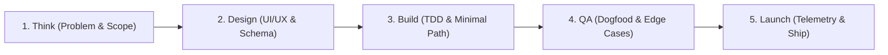

# Garry Tan & YC Product Launch Workflow (`gstack`)

## Overview
A high-velocity, disciplined software shipping methodology inspired by Garry Tan's engineering playbook and Y Combinator startup execution. It balances rapid product momentum with strict architectural quality across 5 sequential gates: Think $
ightarrow$ Design $
ightarrow$ Build $
ightarrow$ QA $
ightarrow$ Launch.

## The 5 Core Gates

### Gate 1: Think (Ruthless Scoping)
- **User Problem Statement**: What acute pain does this solve? Why does the user care today?
- **The "Hair on Fire" MVP**: Cut 70% of feature ideas. Keep only the single critical path that delivers core value.
- **Metric of Truth**: Define 1 quantitative metric (e.g., successful visual execution, latency < 100ms, conversion rate).

### Gate 2: Design (High Taste & Clarity)
- **Anti-Slop Visual Hierarchy**: Clear typography, authentic color palette, obvious primary call-to-action.
- **State Design**: Map empty states, loading skeletons, error fallbacks, and success confirmations before coding.
- **Data Model**: Minimal schema with strict foreign keys and nullability constraints.

### Gate 3: Build (Vertical Slice Engineering)
- Build full end-to-end functionality for the single critical user journey first.
- Write tests for core business logic before implementation (TDD).
- Avoid premature architectural abstractions or speculative microservices.

### Gate 4: QA (Internal Dogfooding)
- Run the feature manually through 5 real scenarios with realistic messy data.
- Check accessibility (WCAG AA), responsive mobile layout, and offline/slow-network tolerance.
- Zero open P0/P1 bugs permitted past this gate.

### Gate 5: Launch (Ship & Measure)
- Instrument telemetry and error tracking (Sentry / Datadog) before flipping release flags.
- Document release notes with clear user-facing benefits, not raw commit hashes.
- Gather feedback from the first 10 users within 24 hours of release.

## Execution Checklist
| Gate | Deliverable | Success Criteria |
| :--- | :--- | :--- |
| **Think** | 1-page Problem Spec | 1 metric defined, non-essential features cut |
| **Design** | UI Mockup + DB Schema | Tokens defined, empty/error states resolved |
| **Build** | Working PR + Unit Tests | 100% critical path functional, tests passing |
| **QA** | QA Dogfood Verification | Zero console errors, responsive on mobile |
| **Launch** | Release Notes + Live URL | Telemetry active, user feedback link shared |\n