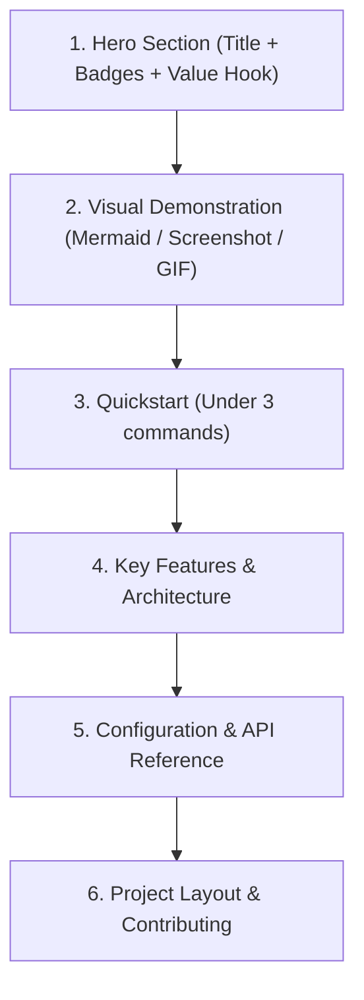

# Professional README Crafting

Author compelling, developer-friendly, and high-conversion GitHub `README.md` files that communicate project value within 5 seconds of scanning.

## When to Use
- Creating a `README.md` for a new repository or open-source tool.
- Upgrading an existing, messy, or sparse README into a production-grade document.
- Structuring installation, quickstarts, architecture diagrams, and CLI commands.

---

## The 7-Second Rule & Hierarchy of Information

A great README answers three questions in under 7 seconds:
1. **What is this?** (1-line punchy hook)
2. **Why should I care / What problem does it solve?** (Clear differentiation)
3. **How do I run it right now?** (1-line copy-paste command)



---

## Core Sections of a World-Class README

### 1. Hero Section (Anti-Generic)
- **Title**: Clean branding with an appropriate emoji.
- **Badges**: CI/CD build status, release version, license, test coverage, package downloads (shields.io).
- **The One-Liner**: An active, confident summary of the problem solved. Avoid generic buzzwords ("revolutionary AI-powered next-generation tool").
  - *Example*: *"Zero-latency vector search engine built on SQLite FTS5 with sub-millisecond retrieval."*

### 2. Architecture & How It Works (Visual First)
- Include a concise Mermaid flowchart or sequence diagram. Developers understand diagrams 10x faster than paragraphs of text.
- Highlight the data flow from input to output.

### 3. Frictionless Quickstart
- Never bury the run command under 5 paragraphs of prerequisites.
- Provide a single, deterministic code block:
  ```bash
  # Clone and setup in 30 seconds
  git clone https://github.com/user/repo.git
  cd repo && npm install
  npm run dev
  ```

### 4. Key Feature Bento Grid / Matrix
- Use concise bullet points with bold keywords.
- Compare against traditional alternatives (Feature Comparison Table) when relevant.

### 5. Configuration & Environment Variables
- Document critical environment variables in a clean markdown table:
  | Variable | Type | Default | Description |
  | :--- | :--- | :--- | :--- |
  | `DATABASE_URL` | String | Required | PostgreSQL connection URI |
  | `PORT` | Integer | `3000` | HTTP listening port |

### 6. Repository Layout (Clean Tree)
- Provide an annotated directory tree showing key folders without overwhelming the reader with node_modules or build junk.

### 7. Contributing, Community & License
- Link to `CONTRIBUTING.md`, code of conduct, and clear MIT/Apache 2.0 license.

## Output Deliverables
Produce the project README following `workflows/templates/README-TEMPLATE.md`.
