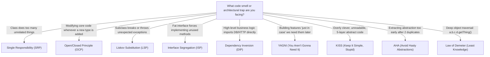

# Software Engineering Principles: SOLID, YAGNI, KISS & Beyond

Apply battle-tested software engineering heuristics to build clean, maintainable, and bug-resistant systems while avoiding premature abstraction and design paralysis.

## When to Use
- Designing new classes, modules, or services.
- Conducting code reviews or refactoring legacy codebases.
- Resolving debates about code duplication vs abstraction (DRY vs AHA).
- Preventing over-engineering and speculative complexity (YAGNI).

---

## 1. Quick Principle Matrix



---

## 2. The SOLID Principles (With Modern Refactoring Patterns)

### S — Single Responsibility Principle (SRP)
> *"A class or module should have one, and only one, reason to change."*
- **Smell**: A `UserService` that validates passwords, hashes them, executes raw SQL queries, and sends welcome emails via SMTP.
- **Fix**: Decompose into focused single-purpose units:
  - `UserValidator`: Validates constraints.
  - `UserRepository`: Manages persistence.
  - `NotificationService`: Handles email dispatch.
  - `UserService`: Orchestrates the business transaction.

### O — Open/Closed Principle (OCP)
> *"Software entities should be open for extension, but closed for modification."*
- **Smell**: A payment handler with a giant `switch (type)` statement:
  ```typescript
  // BAD: Every new payment gateway forces modifying this core function
  function process(p: Payment) {
    if (p.type === 'STRIPE') stripe.charge(p);
    else if (p.type === 'PAYPAL') paypal.pay(p);
    else if (p.type === 'CRYPTO') crypto.send(p);
  }
  ```
- **Fix**: Use polymorphism / Strategy pattern:
  ```typescript
  // GOOD: Add new gateways by adding a new class implementing the interface
  interface PaymentGateway {
    charge(payment: Payment): Promise<Receipt>;
  }
  ```

### L — Liskov Substitution Principle (LSP)
> *"Subtypes must be substitutable for their base types without altering program correctness."*
- **Smell**: Subclass overrides a base method by throwing `UnsupportedOperationException`, or silently doing nothing, or changing return invariants (The classic `Square extends Rectangle` trap).
- **Rule**: If a subclass cannot fulfill the full semantic contract of the base class, **do not inherit**. Use composition instead.

### I — Interface Segregation Principle (ISP)
> *"Clients should not be forced to depend on methods they do not use."*
- **Smell**: A bloated `WorkerInterface` with `code()`, `test()`, `deploy()`, and `review()`. A junior dev class has to implement empty dummy methods for `deploy()`.
- **Fix**: Segregate into small, role-specific interfaces:
  `CodeWriter`, `TestRunner`, `Deployer`. Classes implement only what they actually do.

### D — Dependency Inversion Principle (DIP)
> *"High-level modules should not depend on low-level modules; both should depend on abstractions."*
- **Smell**: Core `OrderService` directly instantiates `new PostgresOrderDao()` or `new S3Uploader()`.
- **Fix**: `OrderService` depends on `OrderRepositoryPort` (an interface). The PostgreSQL implementation is injected at runtime via Dependency Injection.

---

## 3. The Pragmatic Clean Code Heuristics

### A. YAGNI (You Aren't Gonna Need It)
- **The Rule**: Never add functionality or abstraction based on speculation of future requirements.
- **Red Flags**:
  - *"Let's build a plugin system now in case we need other DBs later."*
  - *"Let's add 10 extra fields to the user table just in case."*
  - *"Let's make this generic across 5 data types even though we only have 1 today."*
- **Action**: Implement strictly what is required to satisfy today's acceptance criteria. Refactor when real requirements arrive.

### B. KISS (Keep It Simple, Stupid)
- **The Rule**: Simplicity is a prerequisite for reliability. Avoid clever, obscure, or overly compressed code.
- **Guidelines**:
  - Prefer a clear, readable 5-line `for` loop over a convoluted 1-line nested regex or arcane reducer.
  - Keep nesting depth $\le 3$. Use **Guard Clauses (Early Returns)** to eliminate deep indentation:
    ```typescript
    // GOOD: Early exit guard clauses
    function processUser(user: User | null) {
      if (!user) return;
      if (!user.isActive) return;
      if (user.isBanned) return;
      
      // Happy path executed at root indentation level
      executeOrder(user);
    }
    ```

### C. DRY vs. AHA (Avoid Hasty Abstractions)
- **DRY (Don't Repeat Yourself)**: Eliminate duplicate domain knowledge and business rules.
- **AHA Warning (Sandi Metz's Law)**: *"Duplication is far cheaper than the wrong abstraction."*
- **The Rule of Three**:
  - Duplicate 1: Write it.
  - Duplicate 2: Tolerate it. Take note.
  - Duplicate 3: Refactor into a clean abstraction.
  - *Never abstract after seeing a pattern only twice!* Often, two similar pieces of code have different underlying reasons to change.

### D. Law of Demeter (Principle of Least Knowledge)
- **The Rule**: Talk only to your immediate collaborators. Avoid "Train Wrecks":
  ```typescript
  // BAD: Violation of Demeter (Train wreck)
  const discount = order.getCustomer().getProfile().getMembership().getDiscountRate();

  // GOOD: Tell, Don't Ask
  const discount = order.calculateDiscount();
  ```

### E. Fail-Fast & Defensive Validation
- Validate inputs, permissions, and invariants at the system boundary (API Controller / Public function entry).
- Fail immediately with an unambiguous error rather than letting invalid data propagate deep into downstream logic where it causes obscure `NullPointerException`s or database corruption.

### F. The Boy Scout Rule
- *"Always leave the campground cleaner than you found it."*
- Whenever modifying a file to fix a bug or add a feature, clean up at least one small adjacent issue: fix a misleading variable name, remove a dead comment, or simplify an obscure conditional.
