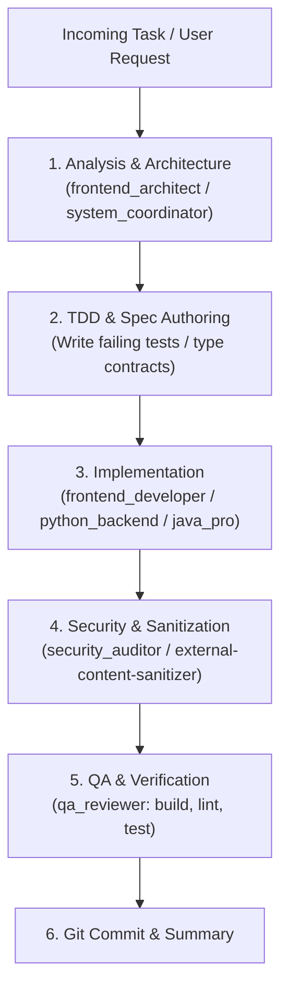

# AGENTS.md — Constitution & Operational Rules for Autonomous Agents

> **Single Source of Truth for Autonomous AI Agents & Subagents working on Student Dating**
> Every autonomous agent operating in this repository MUST strictly abide by the rules, constraints, and engineering workflows defined below.

---

## 1. Core Operating Principles (Nguyên tắc cốt lõi)

1. **Evidence Over Assertion**: Never declare a task complete, a bug fixed, or a feature working without running concrete verification commands (`npm run build`, tests, or runtime scripts) and inspecting the actual execution output.
2. **Zero-Assumption Policy**: Never guess existing types, function contracts, API responses, or database schemas. Always read the source files, inspect dependencies, or ask for clarification before writing implementation code.
3. **Surgical Precision**: Make targeted, minimal diffs. Do not touch or reformat unrelated code, comments, or imports. Preserve existing architecture and docstrings.
4. **Token Hygiene & High-Signal Communication**:
   - Use bounded reads (`StartLine`/`EndLine`) instead of reading whole massive files.
   - Omit fluff, pleasantries, repetitive summaries, and verbatim code echoing.
   - Provide direct, actionable outputs.

---

## 2. Engineering & Code Standards

### 2.1 TypeScript & Node.js Rules
- **Strict Typing**: Strict mode enabled (`tsconfig.json`). Never use `any` without an explicit, documented reason. Prefer `unknown`, generics, or discriminated unions.
- **Runtime Validation**: External data (API requests, user inputs, database payloads) MUST be validated at system boundaries (e.g., using `zod`).
- **Immutability by Default**: Use `const`, `readonly` properties, and pure functions where feasible. Avoid mutating function parameters.
- **Explicit Returns**: Exported functions and public API methods must have explicit return type annotations.
- **Async/Await & Error Handling**:
  - Always `await` Promises or explicitly return them.
  - Never swallow errors with empty `catch {}` blocks.
  - Throw typed domain errors or wrap lower-level exceptions with relevant contextual data.

### 2.2 Project Structure & Architecture
Maintain clean separation of concerns:
```
src/
├── config/         # Environment variables & runtime configurations
├── core/           # Domain entities, value objects, business rules (framework-agnostic)
├── modules/        # Feature slices (e.g., auth, profile, matching, chat)
│   ├── dto/        # Data transfer objects & input validation schemas
│   ├── services/   # Business logic & application use-cases
│   └── controllers/# API route handlers / event listeners
├── infrastructure/ # Database connectors, external APIs, storage, cache
└── shared/         # Common utilities, error classes, constants, types
```

---

## 3. Subagent Orchestration & Lifecycle Workflow

All non-trivial tasks must follow the designated subagent pipeline:



### Subagent Roles & Responsibilities:
- **`system_coordinator`**: Break down complex requirements, manage execution plan, coordinate specialists.
- **`frontend_architect` / `frontend_developer`**: Maintain clean component hierarchy, UI state management, and responsive layouts.
- **`ui_ux_designer` / `taste_craftsman`**: Enforce anti-slop visual design, WCAG AA accessibility, proper typography, and consistent color tokens.
- **`security_auditor`**: Enforce threat modeling, input sanitization, authentication security, and student data privacy.
- **`qa_reviewer`**: Run test suites, verify builds, perform two-axis code reviews, and audit accessibility.

---

## 4. Security, Privacy & Compliance (Dating Domain Specifics)

Because this platform handles sensitive student dating data:
1. **Privacy by Design**:
   - Never log sensitive user data (passwords, private messages, sexual orientation, location coordinates, tokens).
   - Sanitize all user-generated content (bios, messages, profile media) against XSS and injection attacks.
2. **Authentication & Authorization**:
   - Secure token storage, strict password hashing (Argon2id/bcrypt), rate limiting on authentication & swipe endpoints.
   - Proper authorization checks on all user resources (users can only edit/delete their own profiles and messages).
3. **Zero Secrets in Repository**:
   - Never commit `.env` files, API keys, or database credentials. Always provide `.env.example`.

---

## 5. Verification Checklist (Before Claiming Complete)

Before declaring any task complete, the agent MUST execute and verify:
- [ ] **Typecheck**: `npm run build` (or `npx tsc --noEmit`) passes with 0 errors.
- [ ] **Lint / Format**: Code matches project formatting standards.
- [ ] **Tests**: Relevant unit/integration tests run and pass.
- [ ] **No regressions**: Existing functionality remains intact.
- [ ] **Edge cases handled**: Null/undefined inputs, empty arrays, network timeouts, invalid formats.

---

## 6. Git & Commit Conventions

Follow the **Conventional Commits** specification:
- `feat(scope): ...` — A new feature
- `fix(scope): ...` — A bug fix
- `refactor(scope): ...` — Code change that neither fixes a bug nor adds a feature
- `test(scope): ...` — Adding missing tests or correcting existing tests
- `docs(scope): ...` — Documentation only changes
- `chore(scope): ...` — Build process, auxiliary tools, dependencies
