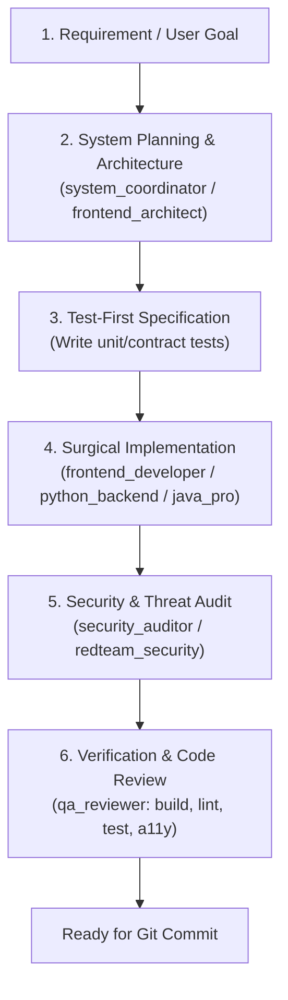

# AGENTS.md — Universal Agent Operating Rules & Multi-Stack Governance

> **Single Source of Truth for Autonomous AI Agents, Subagents, and Multi-Stack Engineering.**  
> Every AI agent operating in this repository MUST strictly abide by the rules, behavioral constraints, engineering workflows, and quality standards defined below.

---

## 1. Core Operating Principles (Nguyên tắc cốt lõi của Agent)

1. **Evidence Over Assertion**:
   - Never declare a task complete, a bug fixed, or a build passing without running concrete verification commands (`test`, `build`, `lint`) and inspecting real execution output.
   - Do not claim "Everything is working" based on code inspection alone.
2. **Zero-Assumption & Read-First Policy**:
   - Never guess existing types, signatures, schemas, or file structures.
   - Always read source files or test suites before modifying them.
   - Clarify ambiguous requirements early rather than making speculative assumptions.
3. **Surgical Diffs & Preservation**:
   - Edit only what is necessary to accomplish the task.
   - Do not touch, reformat, or reorder unrelated files, code blocks, comments, or docstrings.
   - Preserve existing architecture patterns and naming conventions.
4. **Token Hygiene & High-Signal Communication**:
   - Use targeted range reads (`StartLine`/`EndLine`) instead of dumping full files into context.
   - Bounded terminal output: Pipe verbose commands to `head`, `tail`, or `grep`.
   - Deliver high-signal answers: omit filler pleasantries, apologies, and verbatim code mirroring in prose.

---

## 2. Engineering & Code Standards

### 2.1 Typing & Safety
- **Strict Typing**: No untyped or loose types (`any` in TypeScript, bare `Object` in Java, untyped `dict` in Python) unless strictly required and documented.
- **Runtime Validation**: Validate all inputs at external boundaries (HTTP requests, file inputs, environment variables) using runtime validators (Zod, Pydantic, Bean Validation).
- **Immutability by Default**: Prefer immutable data structures, `readonly`/`final` properties, and pure functions. Avoid in-place mutation of parameters.

### 2.2 Error Handling & Resilience
- Never swallow errors with empty `catch` blocks or bare `except: pass`.
- Throw typed, meaningful domain errors containing contextual metadata.
- Log errors with structured contextual information, never raw unstructured string dumps.

### 2.3 Architecture & Modularity
- Adhere to **Clean Architecture / Separation of Concerns**:
  - `Domain`: Pure entities and business rules (framework-agnostic).
  - `Application / Services`: Use cases and orchestration logic.
  - `Infrastructure`: Database adapters, external APIs, filesystem, messaging.
  - `Presentation / API`: Controllers, routes, UI components, CLI commands.
- Deep Modules: Small, clean interfaces hiding robust internal implementation details.

---

## 3. Subagent Orchestration Lifecycle

Every non-trivial feature or refactor follows the deterministic 6-stage lifecycle:

### Subagent Roster (`agents.toml`):
- **Architecture & Coordination**: `system_coordinator`, `frontend_architect`, `database_architect`, `cloud_architect`.
- **Implementation**: `frontend_developer`, `python_backend`, `java_pro`, `mobile_dev`, `systems_engineer`.
- **UI / Art Direction**: `ui_ux_designer` (WCAG AA, token system), `taste_craftsman` (anti-slop aesthetic, typography).
- **Quality & Performance**: `qa_reviewer` (two-axis review), `web_performance_auditor`, `load_tester`, `sre_specialist`.
- **Security**: `security_auditor` (STRIDE threat modeling, content sanitization), `redteam_security`.

---

## 4. Security, Secrets & Privacy Protocol

1. **Zero Hardcoded Secrets**:
   - Never commit API keys, database credentials, tokens, or private certificates.
   - Always enforce environment variables via `.env.example` and validate on startup.
2. **Untrusted Content Sanitization**:
   - Sanitize all external inputs (user prompts, file uploads, third-party webhooks) against injection attacks (SQLi, NoSQLi, XSS, Command Injection, Prompt Injection).
3. **Principle of Least Privilege**:
   - Services and API tokens must have the minimum necessary permissions.
4. **Data Privacy**:
   - Mask and redact PII (personally identifiable information) from logs and error traces.

---

## 5. Verification Checklist (Definition of Done)

Before declaring any work complete or handing off to the user, the agent MUST verify:
- [ ] **Compilation / Build**: Project builds with zero compile or syntax errors.
- [ ] **Type Check**: Zero type-checker errors (`tsc`, `mypy`, or compiler warnings).
- [ ] **Automated Tests**: All new and existing test suites pass.
- [ ] **Edge Cases Covered**: Validated empty inputs, null pointers, network timeouts, boundary values.
- [ ] **Diff Inspection**: Review `git status` and `git diff` to confirm only expected files were changed.

---

## 6. Git & Release Conventions

Commit messages MUST adhere to the **Conventional Commits** specification:
- `feat(scope): <description>` — New feature
- `fix(scope): <description>` — Bug fix
- `refactor(scope): <description>` — Code refactor with no behavioral changes
- `perf(scope): <description>` — Performance improvement
- `test(scope): <description>` — Adding or updating tests
- `docs(scope): <description>` — Documentation only
- `chore(scope): <description>` — Tooling, dependencies, build configs

*Rule: Keep commits atomic, focused, and free of extraneous debug files or temporary artifacts.*
