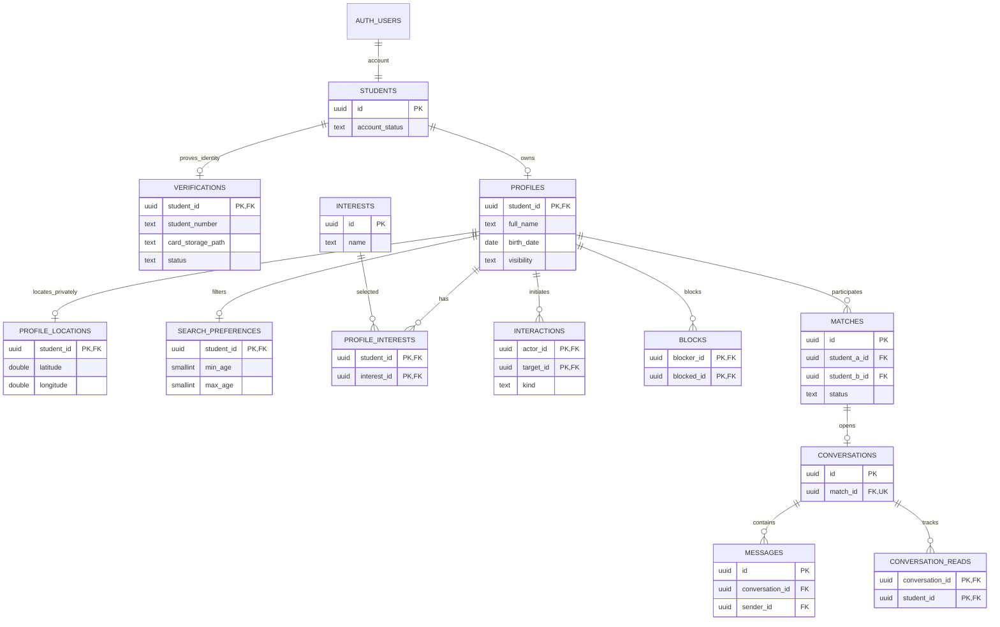

# Student Dating — Database Architecture & Schema

## 1. Overview & technology selection

- **Engine:** PostgreSQL managed by Supabase. The supplied host identifies the intended project; no credentials are stored here.
- **Authentication:** Supabase Auth (`auth.users`) owns email, password and email OTP. Do not add a second password or OTP table.
- **Query layer:** `src/database.ts` provides a server-side PostgreSQL pool and `npm run db:check` tests connectivity. Domain classes still use in-memory state; no application flow writes to this pool yet.
- **Migration:** [`20261031000000_initial_student_dating.sql`](../../supabase/migrations/20261031000000_initial_student_dating.sql) is an initial migration for an empty Supabase project. Run it only after checking the target project and taking a backup if it contains data.
- **Names:** plural `snake_case` tables/columns, UUID keys aligned with `auth.users.id`, `timestamptz` for instants.

The attached sports-court booking diagram is not the domain of this repository. This schema follows the implemented student verification, recommendation, interaction, match and chat models.

## 2. Entity-relationship diagram

`AUTH_USERS` is Supabase managed. `VERIFICATIONS` and `PROFILE_LOCATIONS` are in the `student_private` schema; all other application tables are in `public`.

## 3. Physical schema and domain mapping

The migration is the single source of truth for DDL. Key mappings from the current TypeScript models:

| Code | Database | Note |
| --- | --- | --- |
| `StudentAccountManager` | `auth.users`, `students`, `profiles` | `email` stays in Auth; `fullName` is `profiles.full_name`. |
| `CampusVerification` | `auth.users`, `student_private.verifications` | Supabase Auth handles email OTP; card/CCCD path and review decision are private. |
| `SinhVien`, `HoSoHenHo` | `students`, `profiles`, `student_private.profile_locations` | Exact GPS coordinates are never exposed through the Data API. |
| `SoThich`, `TieuChiTimKiem` | `interests`, `profile_interests`, `search_preferences` | Many-to-many interests use an explicit join table. |
| `LuotThich`, `ChanNguoiDung` | `interactions`, `blocks` | One interaction per ordered pair; blocking is directional. |
| `KetNoi`, `CuocTroChuyen`, `TinNhan` | `matches`, `conversations`, `messages`, `conversation_reads` | One conversation per match; read state is per participant. |

`matches.student_a_id < student_b_id` stores each pair in one canonical order. A match is created by the trusted server only after two `THICH` interactions, with no block in either direction and both accounts eligible. Creating a block must cancel any active match/conversation for that pair in the same transaction. Chat sends must be checked by the server for active match, active conversation, sender membership and block state. These cross-table rules are **not** enforced by the DDL alone.

## 4. Security and access

- Every application table has RLS enabled. `student_private` has no Data API grants or RLS policies, so its data is accessible only to privileged server processes.
- A signed-in user can read their own account, profile, preferences, interactions and blocks; matched users can read each other's visible profile and chat history. `anon` has no table grants.
- Clients can edit their own profile, interest selections and search preferences. They cannot write verification decisions, interactions, blocks, matches or chat records directly. The trusted backend must implement these commands, verify the caller, and use a privileged PostgreSQL connection for `student_private` data.
- `students.account_status` and `profiles.visibility` are distinct. Only the backend may lock an account or set `BI_KHOA`/`NGUNG_SU_DUNG`.
- Profile discovery is a backend query because unmatched profiles are not readable through the Data API. That backend must filter verification status, age, visibility, blocks, prior interactions and location criteria. Do not expose exact coordinates or card image URLs.
- Store card/CCCD files in a private Supabase Storage bucket with separate Storage policies; the database keeps only an object path. The migration does not create that bucket.

## 5. Indexing and migration strategy

Foreign keys not covered by a leading primary/unique key have indexes. `matches` has partial indexes for active pair lookups; `messages` has a conversation/time index for chronological paging. Check query plans after real data exists before adding more indexes.

This is an initial schema: no rollback script or data backfill is included because the repository has no prior database schema. If this project already has tables or users, review and adapt the migration before applying it. Future breaking changes should use the repository's expand/backfill/switch/contract workflow.

**Deployment record (2026-10-31):** Applied migration `20261031000000` to Supabase project `qsnwyxjqrpskochuvtod` with Supabase CLI 2.122.0. A read-only check afterward found 13 application tables, RLS enabled on all 13, 19 policies and a matching migration-history entry. The private schema was inaccessible to `anon` and `authenticated` in the privilege check.

## 6. Integration work still required

The existing TypeScript classes use memory maps, so the new connection configuration does not yet persist application data to Supabase. The backend still needs an Auth signup hook/service to create `students` and require a `.edu.vn` email, API authorization for privileged writes, Storage policy for identity images, and integration tests for RLS using two distinct user identities. `updated_at` fields must be set by application writes; there is no automatic trigger in this initial design.
