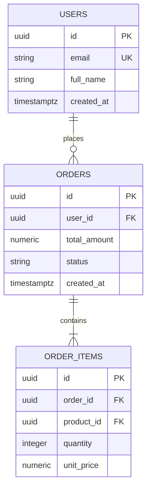

# Database Architecture & Schema Specification

## 1. Overview & Technology Selection
- **Database Engine**: [e.g., PostgreSQL 16 / MySQL 8.4 / SQLite 3]
- **ORM / Query Layer**: [e.g., Prisma / Drizzle / SQLAlchemy / Hibernate / Raw SQL]
- **Migration Tool**: [e.g., Flyway / Liquibase / Prisma Migrate / Alembic]
- **Naming Conventions**: `snake_case` for tables and columns; plural for table names (e.g., `users`, `order_items`).

---

## 2. Entity-Relationship Diagram (ERD)



---

## 3. Physical Schema Definition (DDL)

```sql
-- Extensions
CREATE EXTENSION IF NOT EXISTS "uuid-ossp";

-- Table: users
CREATE TABLE users (
    id UUID PRIMARY KEY DEFAULT gen_random_uuid(),
    email VARCHAR(255) NOT NULL UNIQUE,
    password_hash VARCHAR(255) NOT NULL,
    full_name VARCHAR(100) NOT NULL,
    role VARCHAR(50) NOT NULL DEFAULT 'CUSTOMER' CHECK (role IN ('CUSTOMER', 'ADMIN', 'MODERATOR')),
    created_at TIMESTAMPTZ NOT NULL DEFAULT clock_timestamp(),
    updated_at TIMESTAMPTZ NOT NULL DEFAULT clock_timestamp()
);

-- Table: orders
CREATE TABLE orders (
    id UUID PRIMARY KEY DEFAULT gen_random_uuid(),
    user_id UUID NOT NULL REFERENCES users(id) ON DELETE RESTRICT,
    total_amount NUMERIC(12, 2) NOT NULL CHECK (total_amount >= 0),
    status VARCHAR(50) NOT NULL DEFAULT 'PENDING' CHECK (status IN ('PENDING', 'PAID', 'SHIPPED', 'CANCELLED')),
    created_at TIMESTAMPTZ NOT NULL DEFAULT clock_timestamp(),
    updated_at TIMESTAMPTZ NOT NULL DEFAULT clock_timestamp()
);

-- Table: order_items
CREATE TABLE order_items (
    id UUID PRIMARY KEY DEFAULT gen_random_uuid(),
    order_id UUID NOT NULL REFERENCES orders(id) ON DELETE CASCADE,
    product_id UUID NOT NULL,
    quantity INTEGER NOT NULL CHECK (quantity > 0),
    unit_price NUMERIC(12, 2) NOT NULL CHECK (unit_price >= 0),
    created_at TIMESTAMPTZ NOT NULL DEFAULT clock_timestamp()
);
```

---

## 4. Indexing & Optimization Strategy

```sql
-- Foreign Key Indexes (Crucial for JOIN performance and foreign key lock prevention)
CREATE INDEX idx_orders_user_id ON orders (user_id);
CREATE INDEX idx_order_items_order_id ON order_items (order_id);

-- Query-Specific Partial Indexes
CREATE INDEX idx_orders_pending ON orders (created_at) WHERE status = 'PENDING';

-- Composite Index for Customer Order History Lookup
CREATE INDEX idx_orders_user_created ON orders (user_id, created_at DESC);
```

---

## 5. Migration & Rollback Strategy
- **Migration Script**: `migrations/V1__init_schema.sql`
- **Rollback Script**: `migrations/U1__init_schema.sql` (Drops tables in reverse foreign key order)
- **Data Backfill Rules**: [Instructions for seed or legacy data if applicable]
