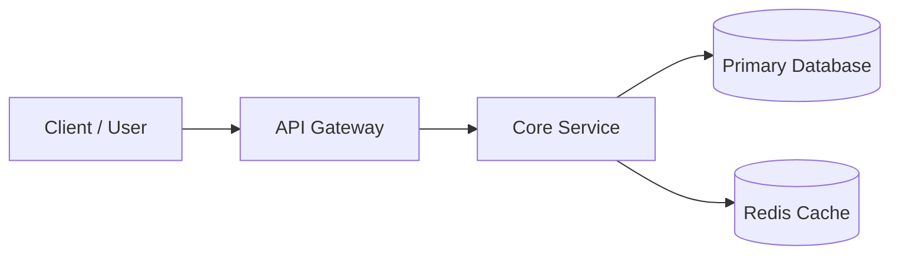

<div align="center">

# 🚀 [Project Name]

**[One punchy sentence describing the core value proposition and problem solved.]**

[](https://github.com/username/repo/actions)
[](https://github.com/username/repo/releases)
[](https://opensource.org/licenses/MIT)
[](http://makeapullrequest.com)

</div>

---

## 💡 Why [Project Name]?

[1-2 paragraphs detailing the painful problem developers/users face, and how this architecture or tool solves it fundamentally better than existing options.]

### ✨ Key Capabilities
- ⚡ **High Performance**: [Measurable metric, e.g. <5ms response latency under 1k req/s].
- 🛡️ **Zero Vulnerability Surface**: [Built-in security control or validation].
- 🧩 **Modular & Extensible**: [Plugin architecture or clean decoupling].
- 📦 **Zero-Config Quickstart**: [Works out of the box with reasonable defaults].

---

## 🏛️ System Architecture



---

## 🚀 Quickstart

### Prerequisites
- Node.js 20+ / Python 3.11+ / Docker
- Git

### Installation

```bash
# 1. Clone the repository
git clone https://github.com/username/repo.git
cd repo

# 2. Setup environment variables
cp .env.example .env

# 3. Install dependencies and start
npm install
npm run dev
```

Visit `http://localhost:3000` to see the application live.

---

## ⚙️ Configuration Reference

| Environment Variable | Type | Default | Description |
| :--- | :--- | :--- | :--- |
| `DATABASE_URL` | String | *Required* | PostgreSQL connection string |
| `REDIS_URL` | String | `redis://localhost:6379` | Cache connection URI |
| `NODE_ENV` | String | `development` | Runtime environment (`development` / `production`) |
| `PORT` | Integer | `3000` | Port for the HTTP server to bind |

---

## 📁 Repository Structure

```text
├── src/
│   ├── api/             # HTTP route handlers & public contracts
│   ├── core/            # Deep business logic & services
│   ├── db/              # Migrations, schemas, and query models
│   └── utils/           # Shared helpers and formatters
├── tests/               # Unit, integration, and E2E test suites
├── docker-compose.yml   # Multi-service local environment
└── README.md            # You are here
```

---

## 🤝 Contributing

Contributions are welcome! Please read our [Contributing Guide](CONTRIBUTING.md) and submit a pull request.

1. Fork the Project
2. Create your Feature Branch (`git checkout -b feat/amazing-feature`)
3. Commit your Changes (`git commit -m 'feat: add amazing feature'`)
4. Push to the Branch (`git push origin feat/amazing-feature`)
5. Open a Pull Request

---

## 📄 License

Distributed under the MIT License. See [LICENSE](LICENSE) for more information.
