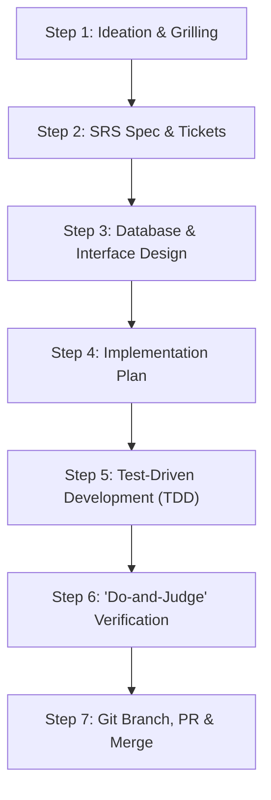

# Workflow 1: Standard Feature Development Lifecycle

A step-by-step, deterministic runbook for developing any new feature from initial user prompt to production-ready Pull Request.

---

## Step 1: Ideation & Grilling
- **Trigger**: User provides a feature request or concept.
- **Action**:
  1. If requirements are underspecified, invoke `grill-me` or `grill-with-docs`.
  2. Ask 3-5 sharp, multiple-choice or focused questions to nail down edge cases, permissions, and non-goals.
  3. Record consensus in an Architecture Decision Record if there are significant trade-offs (`workflows/templates/ADR-TEMPLATE.md`).

---

## Step 2: SRS Spec & Task Breakdown
- **Action**:
  1. Invoke `srs-authoring` to draft or update the functional specification using `workflows/templates/SRS-TEMPLATE.md`.
  2. Define explicit **In-Scope** vs **Out-of-Scope (YAGNI)** boundaries.
  3. Write testable Gherkin scenarios (Given-When-Then).
  4. Invoke `to-tickets` to decompose into tracer-bullet tickets with dependency blocking links (`#01 blocks #02`).

---

## Step 3: Database & Interface Design
- **Action**:
  1. If entities or relations change, invoke `database-design`.
  2. Draw Mermaid ERD diagram.
  3. Write DDL migration script with UUIDv7/BIGSERIAL PKs, explicit foreign key constraints, and indexes on all foreign keys.
  4. If multiple services interact, invoke `design-patterns` to define Port interfaces (Hexagonal / Clean Architecture).

---

## Step 4: Implementation Plan
- **Action**:
  1. Invoke `writing-plans` using `workflows/templates/PLAN-TEMPLATE.md`.
  2. Divide work into bite-sized tasks (under 20 minutes each).
  3. Specify exact target files and exact verification test commands for every task.

---

## Step 5: Test-Driven Development (TDD)
- **Action**:
  1. **Red**: Write a failing unit or integration test reproducing the desired capability (`test-driven-development`).
  2. **Green**: Implement the minimal viable production code to pass the test (`incremental-implementation`).
  3. **Refactor**: Simplify and clean code without changing behavior (`code-simplification`).
  4. Apply Token Hygiene: use precision slicing (`view_file` with line bounds) and atomic diff edits.

---

## Step 6: "Do-and-Judge" Verification
- **Action**:
  1. Invoke `verification-before-completion`: Run test suite and confirm 100% green output.
  2. Spawn an isolated reviewer agent (`qa_reviewer`) with a clean context window to evaluate the diff against the original SRS specification.
  3. Verify accessibility (WCAG AA) and web performance (Core Web Vitals).

---

## Step 7: Git Branch, PR & Merge
- **Action**:
  1. Invoke `github-pr-and-collaboration`.
  2. Create atomic Conventional Commits (`feat(auth): add JWT refresh token rotation`).
  3. Push to `feat/feature-name` (using `--force-with-lease` if rebased).
  4. Open Pull Request using `workflows/templates/PR-TEMPLATE.md` with passing test evidence.
