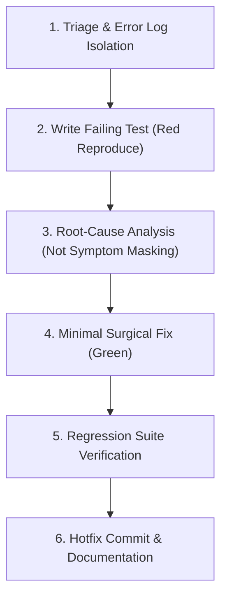

# Workflow 2: Bugfix & Root-Cause Diagnosis Runbook

A systematic, evidence-driven workflow for diagnosing, reproducing, and fixing bugs without causing regressions.

---

## Step 1: Triage & Error Log Isolation
- **Trigger**: Sentry exception, customer bug report, or test failure.
- **Action**:
  1. Do NOT dump the full 500-line server log into LLM memory.
  2. Use bounded shell filtering (`grep -C 5 "Exception" app.log | head -n 30`).
  3. Identify the exact failing module, input payload, and stack trace.

---

## Step 2: Write Failing Regression Test (Red)
- **Golden Rule**: **NEVER write fix code before writing a failing test.**
- **Action**:
  1. Create a unit or integration test recreating the exact input that caused the bug.
  2. Run the test command and verify it fails with the expected error.
  3. This guarantees the bug is real and prevents future regressions.

---

## Step 3: Root-Cause Analysis (Systematic Debugging)
- **Action**:
  1. Invoke `systematic-debugging`.
  2. Formulate 2-3 hypotheses for why the failure occurs.
  3. Inspect variables and state transitions at the boundary seam.
  4. Avoid "quick patches" or symptom masking (e.g., adding `if (x != null)` without understanding why `x` was null in the first place).

---

## Step 4: Minimal Surgical Fix (Green)
- **Action**:
  1. Make the smallest contiguous edit necessary to resolve the root cause.
  2. Re-run the reproduction test.
  3. Confirm the test transitions from Red to Green.

---

## Step 5: Regression Suite Verification
- **Action**:
  1. Run the entire related test package to ensure no downstream features broke.
  2. Invoke `verification-before-completion`.

---

## Step 6: Hotfix Commit & Documentation
- **Action**:
  1. Commit using Conventional Commits: `fix(order): handle currency conversion precision loss`.
  2. Include issue link (`Fixes #312`).
  3. Push to `fix/issue-description` and open PR.
