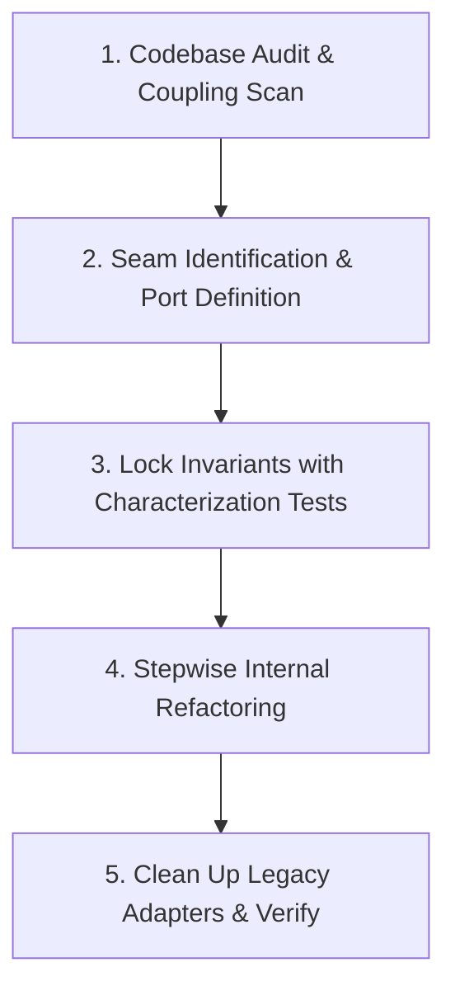

# Workflow 3: Codebase Refactoring & Deep Module Engineering

A disciplined workflow to untangle spaghetti code, reduce coupling, and deepen module interfaces based on John Ousterhout's *A Philosophy of Software Design*.

---

## Step 1: Codebase Audit & Coupling Scan
- **Action**:
  1. Invoke `improve-codebase-architecture` to scan import trees and module boundaries.
  2. Identify "shallow modules" (modules with large complex interfaces that do very little actual work).
  3. Identify circular dependencies or leaky abstractions.

---

## Step 2: Seam Identification & Port Definition
- **Action**:
  1. Invoke `codebase-design`.
  2. Find the natural architectural "seam" where the subsystem interacts with the rest of the app.
  3. Design a **Deep Interface**: Simple, intuitive public methods (e.g. `OrderService.placeOrder(command)`) that hide 15 complex validation and persistence steps inside.
  4. Use `design-patterns` (Hexagonal Port or Facade) to decouple the caller.

---

## Step 3: Characterization Tests (The Safety Net)
- **Action**:
  1. Before touching existing code, ensure tests fully cover existing behavior (characterization tests).
  2. If test coverage is low, write tests that capture current inputs and outputs first.

---

## Step 4: Stepwise Internal Refactoring
- **Action**:
  1. Move logic into private methods / internal subpackages.
  2. Apply `code-simplification`: remove redundant flags, dead variables, and nested conditionals.
  3. Keep tests running continuously on every small step.

---

## Step 5: Verification & Boundary Enforcement
- **Action**:
  1. Run `setup-ts-deep-modules` (dependency-cruiser) or ArchUnit (Java) to forbid external modules from importing internal implementation files directly.
  2. Run the entire test suite and verify zero regressions.
