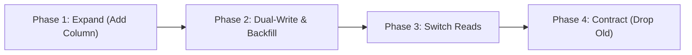

# Workflow 4: Zero-Downtime Database Migration Runbook

A safe, production-proven workflow for modifying database schemas without downtime or locked tables (Expand-and-Contract Pattern).



---

## The Golden Rule of Database Migrations
**Never perform breaking schema changes (renaming columns, dropping columns, changing types) in a single deployment.** Always split into 4 phases.

---

### Phase 1: Expand (Additive Schema Change)
1. Add new column or table as **nullable** or with a safe default:
   ```sql
   ALTER TABLE users ADD COLUMN phone_number_v2 VARCHAR(20);
   ```
2. If adding an index on a large table in PostgreSQL, ALWAYS use `CONCURRENTLY`:
   ```sql
   CREATE INDEX CONCURRENTLY idx_users_phone ON users (phone_number_v2);
   ```
3. Run migration tool (Flyway / Prisma / Alembic). Deploy with zero downtime.

---

### Phase 2: Dual-Write & Background Backfill
1. Update application code to **write to both** `phone_number` (old) and `phone_number_v2` (new).
2. Code continues reading from the old column. Deploy code.
3. Run an asynchronous batch backfill script to copy legacy data in chunks (e.g. 1,000 rows at a time) to prevent locking table rows.

---

### Phase 3: Switch Reads
1. Verify that 100% of rows are synced and backfilled.
2. Update application code to **read from `phone_number_v2`**.
3. Deploy and monitor error rates and latency.

---

### Phase 4: Contract (Cleanup)
1. Stop writing to the old `phone_number` column.
2. Drop or deprecate the old column in a final cleanup migration:
   ```sql
   ALTER TABLE users DROP COLUMN phone_number;
   ```
3. Remove fallback code from application logic.
