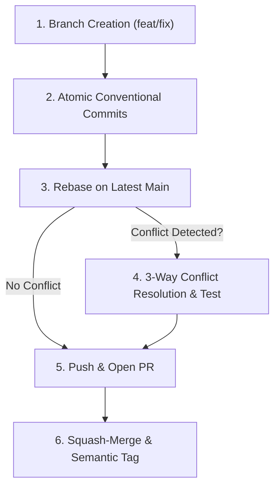

# Workflow 5: Git Collaboration, Conflicts & Semantic Release

The definitive guide for Git branch management, safe rebasing, resolving 3-way merge conflicts, and cutting production releases.



---

## 1. Branch Naming & Hygiene
- Feature branch: `feat/issue-number-short-name`
- Bugfix branch: `fix/issue-number-short-name`
- Refactor branch: `refactor/short-name`
- **Never commit directly to `main` or `master`.**

---

## 2. Conventional Commits
Write atomic commits with a clear scope:
```bash
git commit -m "feat(billing): integrate Stripe webhook for failed payments"
```

---

## 3. Rebase on Main Before Push
Keep history linear and avoid empty merge commits:
```bash
git fetch origin
git rebase origin/main
```

---

## 4. Resolving 3-Way Merge Conflicts
If Git reports a conflict:
1. Identify conflicting files:
   ```bash
   git status
   ```
2. Open conflicting file and inspect markers:
   - `<<<<<<< HEAD`: Your current code.
   - `=======`: Boundary separator.
   - `>>>>>>> origin/main`: The incoming change from main.
3. Synthesize the intended logic by editing the file and removing all markers.
4. **MANDATORY**: Run the automated test suite before continuing!
   ```bash
   npm test # or pytest / mvn test
   ```
5. Mark resolved and continue:
   ```bash
   git add path/to/resolved-file.ts
   git rebase --continue
   ```
6. Safe abort if needed: `git rebase --abort`.

---

## 5. Safe Push & Pull Request
Push your branch to remote:
```bash
git push -u origin feat/your-feature-name
```
If you rebased your branch, use:
```bash
git push --force-with-lease
```
Open a Pull Request with the template at `workflows/templates/PR-TEMPLATE.md`.

---

## 6. Cutting a Semantic Release (SemVer)
When deploying a new version to production:
```bash
# Tag version (vMAJOR.MINOR.PATCH)
git tag -a v1.3.0 -m "Release v1.3.0: Add zero-downtime DB migrations and Stripe billing"
git push origin v1.3.0
```
This triggers the automated release CI/CD workflow to build and push Docker images.
