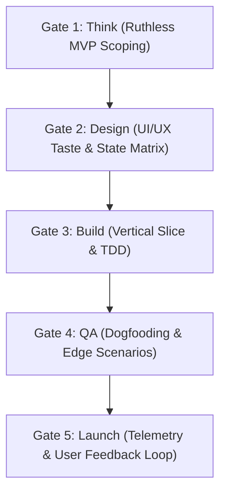

# Workflow 10: Garry Tan & YC Product Launch Runbook (`gstack`)

A high-velocity, disciplined software shipping methodology inspired by Garry Tan's engineering playbook and Y Combinator startup execution. It balances rapid product momentum with strict architectural quality across 5 sequential gates: **Think $\rightarrow$ Design $\rightarrow$ Build $\rightarrow$ QA $\rightarrow$ Launch**.

---

## Gate 1: Think (Ruthless MVP Scoping)
- **Objective**: Identify the single critical user journey and eliminate 70% of feature creep.
- **Actions**:
  1. **Identify the "Hair on Fire" Problem**:
     - What acute pain does this feature resolve for the user right now?
     - Why would the user churn or abandon the workflow without this?
  2. **Select 1 Quantitative North Star Metric**:
     - Examples: "Time-to-first-algorithm-visualization < 5s", "Zero-friction GitHub auth conversion rate > 65%", "95th percentile query latency < 120ms".
  3. **Ruthless Elimination Filter**:
     - Cut any speculative settings, redundant themes, multi-tenant complexity, or premature admin panels.
     - Enforce YAGNI ("You Aren't Gonna Need It").
  4. **Output Artifact**: Create a 1-page Problem & Scope Brief in `docs/PRODUCT-BRIEF.md`.

---

## Gate 2: Design (UI/UX Taste & State Matrix)
- **Objective**: Enforce distinctive visual taste and comprehensive UX edge states before writing code.
- **Actions**:
  1. **Anti-Slop Visual Hierarchy**:
     - Select a bespoke font pairing and purposeful color palette using `taste_craftsman` or `ui_ux_designer`.
     - Avoid generic purple AI gradients, washed-out low-contrast gray text, and bloated decorative cards.
  2. **Map the 4 Core UI States**:
     - **Empty State**: What does the screen show when there is zero user data? (Include an inviting CTA, not a blank box).
     - **Loading State**: Provide subtle layout skeletons or deterministic spinners instead of blank flashes.
     - **Error State**: Provide clear recovery instructions and retry buttons rather than raw stack traces.
     - **Success / Populated State**: Ensure crisp typographical hierarchy and smooth state transitions.
  3. **Data Model & Schema**:
     - Define clean tables/models with UUIDv7 or BIGSERIAL IDs, strict non-null foreign keys, and indexes on query lookup columns.

---

## Gate 3: Build (Vertical Slice & TDD)
- **Objective**: Ship working software end-to-end for the primary user flow.
- **Actions**:
  1. **Tracer-Bullet Vertical Slice**:
     - Implement the complete pipeline for the single happy path first (Database $\rightarrow$ Backend/API $\rightarrow$ Frontend UI).
  2. **Test-Driven Foundation**:
     - Write unit tests for core algorithm/business logic before writing implementation code (`test-driven-development`).
     - Run tests continuously during implementation.
  3. **Avoid Premature Microservices & Abstractions**:
     - Keep logic modular within the existing repository structure.
     - Write clean, readable code with zero speculative indirection.

---

## Gate 4: QA (Dogfooding & Edge Scenarios)
- **Objective**: Prevent customer-facing embarrassment by thoroughly dogfooding.
- **Actions**:
  1. **5 Real Dirty Data Scenarios**:
     - Test with extremely long strings (255+ characters), unicode/emojis, empty arrays, null values, and rapid repetitive button clicking.
  2. **Accessibility & Responsive Audit**:
     - Keyboard navigation: Full tab order and visible `:focus-visible` outlines.
     - Contrast check: Text meets WCAG 2.2 AA (4.5:1 ratio).
     - Screen sanity: Verify layout on 375px mobile viewport and 1440px desktop.
  3. **Console & Log Hygiene**:
     - Ensure zero unhandled promise rejections, zero React hydration mismatches, and zero memory leaks.

---

## Gate 5: Launch (Telemetry & User Feedback Loop)
- **Objective**: Safely release to users with real-time observability and feedback capture.
- **Actions**:
  1. **Instrumentation**:
     - Verify Sentry error tracking / Datadog APM tags are bound to the release version.
     - Verify analytics event logs fire on critical CTA clicks.
  2. **Changelog & Release Notes**:
     - Write release notes focusing on **user value** ("Users can now visualize sorting comparisons in real time") rather than technical chore lists.
  3. **The 24-Hour Feedback Loop**:
     - Monitor error rates for the first 2 hours post-release.
     - Solicit direct feedback from at least 5 target users or internal team members within 24 hours.

---

## Gate Verification Matrix

| Gate | Deliverable | Responsible Subagent | Pass Threshold |
| :--- | :--- | :--- | :--- |
| **Think** | `PRODUCT-BRIEF.md` | `system_coordinator` | 1 North Star metric, 70% scope cut |
| **Design** | State Matrix & UI Spec | `ui_ux_designer`, `taste_craftsman` | 4 states mapped, WCAG AA compliant |
| **Build** | Working PR + Unit Tests | `frontend_developer`, `python_backend`, `java_pro` | 100% test pass rate |
| **QA** | QA Verification Report | `qa_reviewer` | Zero P0/P1 bugs, 0 console errors |
| **Launch** | Release Notes + Telemetry | `devops_engineer`, `sre_specialist` | Error budget intact, monitoring live |
